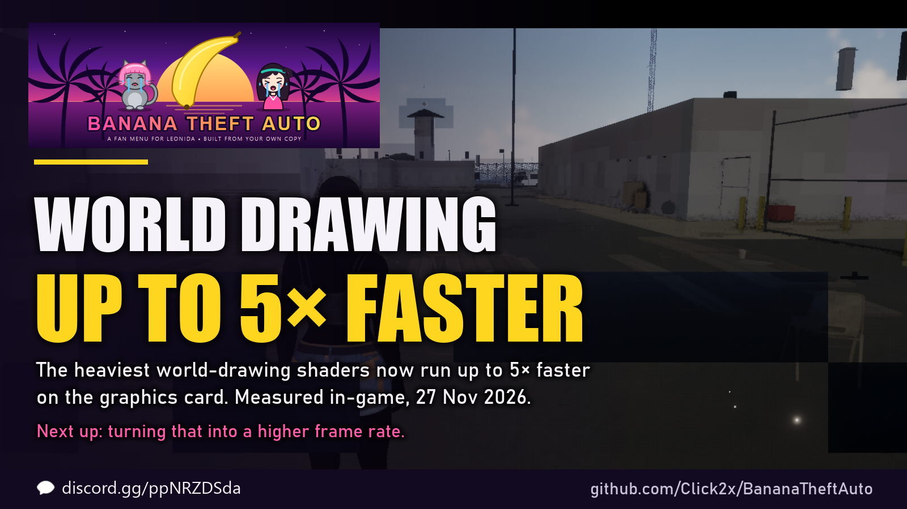
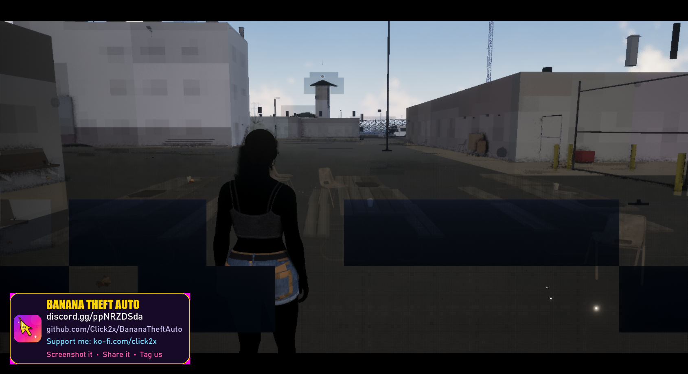
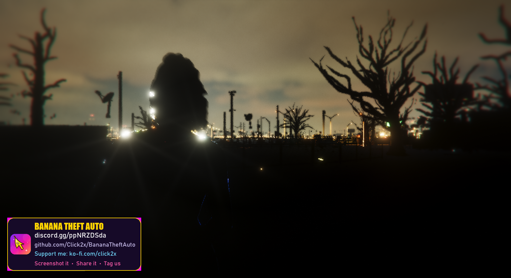
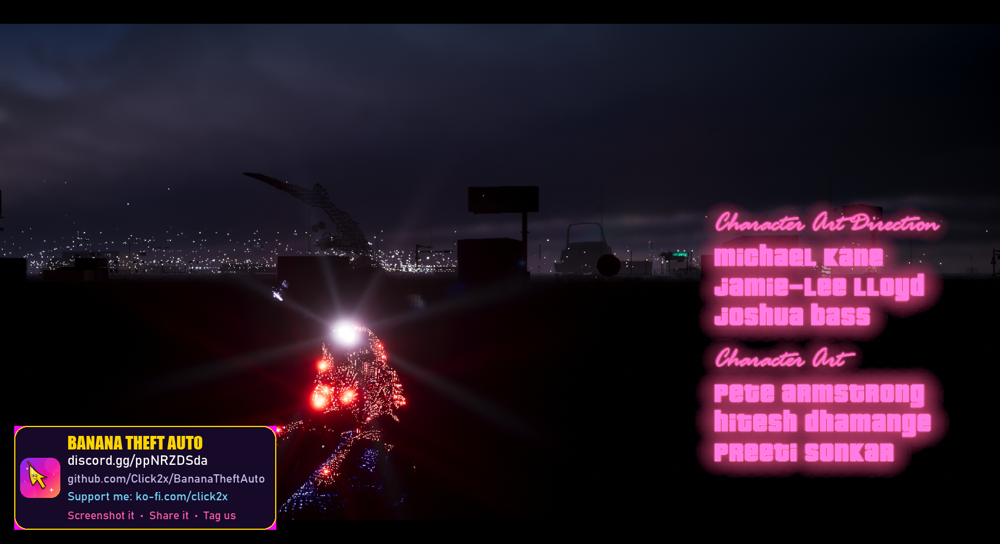
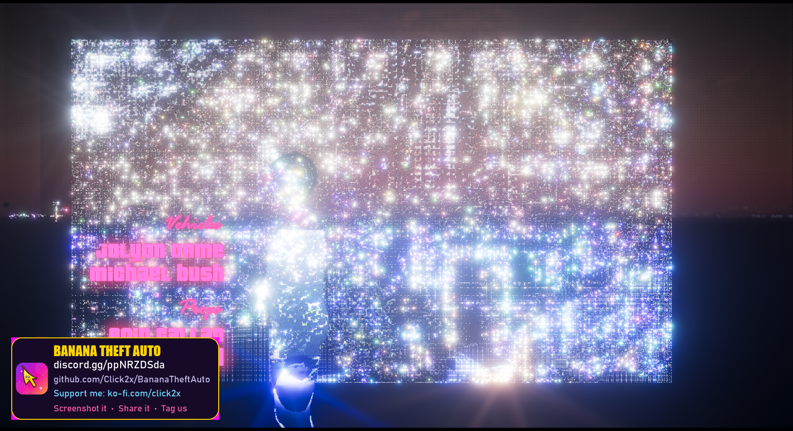
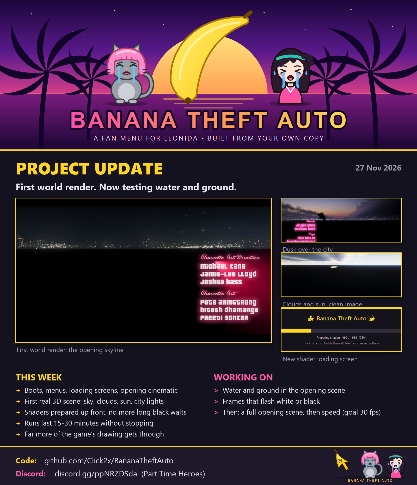
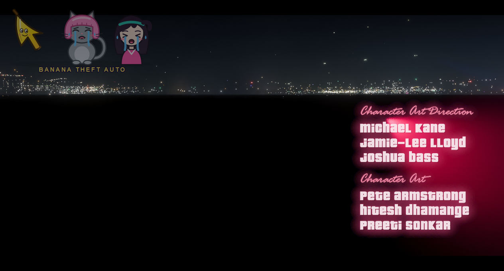

# 🍌 Banana Theft Auto announcements

What we've posted to the community, newest first. Status only: what changed and what's next.

💬 Join the Part Time Heroes on Discord: https://discord.gg/ppNRZDSda
📂 Code: https://github.com/Click2x/BananaTheftAuto · How we got here: [DEVLOG.md](DEVLOG.md)

---

## 27 Nov 2026 (evening): World drawing up to 5× faster

- ✅ The heaviest world-drawing shaders now run up to 5× faster on the graphics card (measured in-game)
- ✅ Menu: **Update** now also checks your build after a power cut or crash, and every build has a build id
- 🔧 Next up: turning that into a higher frame rate

---

## 27 Nov 2026 (midday): First in-game view

- ✅ The first in-game view: the player standing in a daytime street, with buildings, poles and a tower
- ✅ Every world shader the game asks for is now in, with no crash in a 30-minute run
- ✅ New in the menu: **Update**, to get the latest version in a few clicks ([UPDATING.md](UPDATING.md))
- 🔧 Working on now: lighting that blows out to white within seconds, and sparkly characters

---

## 27 Nov 2026 (morning): The opening credits come to life

- ✅ The opening credits scenes now draw much more fully: rooftops, the skyline, trees, interiors, clouds
- ✅ Another 30-minute run without a crash
- 🔧 Working on now: bright lights that bloom until the frame turns white, and sparkly characters

---

## 27 Nov 2026 (morning): First character on screen

- ✅ The first character is drawn in the world, during the opening credits
- ✅ A 30-minute test run with no crash and no graphics card reset
- 🔧 Working on now: lighting that is far too bright, and frames that flash white or black

---

## 27 Nov 2026: Project update

**Status:** First world render ✅. Now testing water and ground.

**This week's milestones**
- ✅ The game boots, gets through its menus and loading screens, and plays its opening cinematic
- ✅ First real 3D scene: sky, clouds, the sun and the city lights on the horizon
- ✅ A new loading screen prepares shaders up front, so no more long black waits
- ✅ Far fewer crashes: runs now last 15–30 minutes without stopping
- ✅ A much bigger share of the game's drawing now gets through

**Working on now**
- 🔧 Water and ground in the opening scene
- 🔧 Frames that flash white or black

**Next up:** a fully drawn opening scene, then speed. The goal is 30 fps.

---

## 27 Nov 2026: Testing a big drawing fix

We're past the first world render: the opening cinematic is drawing a full sky, clouds, the sun and the city lights on
the horizon, and the image is much cleaner now. Tonight's fixes also unlocked a huge chunk of the game's drawing that
was being skipped before, and we're testing it right now. Water and ground are next on the list. Still slow and still
rough, but every run gets further.

---

## 26 Nov 2026: First world render!

Tonight the game drew its first real 3D scene: the opening cinematic, with a night city skyline across the water and
the credits rolling. It's still rough. Some frames blow out to white or go black, and it runs slowly, but the world is
on screen now. Shaders also load up front behind a new loading screen, so the long black waits are gone.

---

## 26 Nov 2026: Past the loading stalls

Big push today. We found what was causing the long load stalls that stopped the game, and we've been fixing it all
day. A fresh test run is going right now. If it holds up, we should get further past the loading screens than ever
before.
