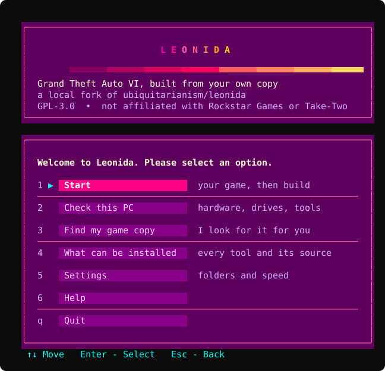
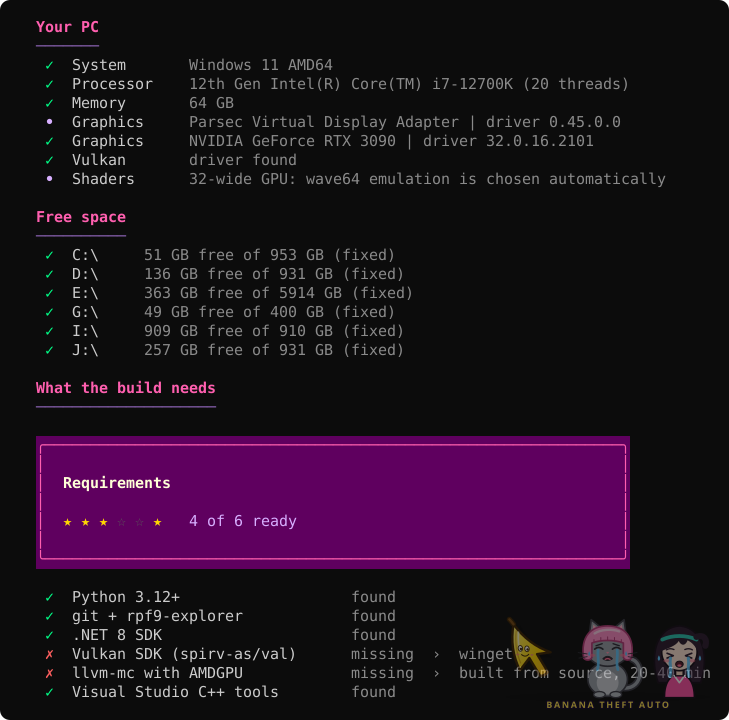
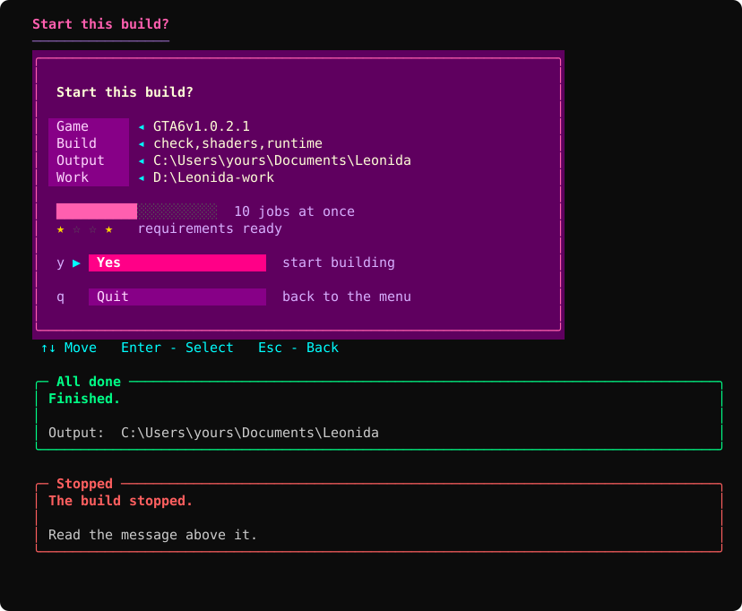

<p align="center"></p>

# Leonida guided menu

A double-click menu for Leonida ([ubiquitarianism/leonida](https://github.com/ubiquitarianism/leonida)), the static recompilation
project for Grand Theft Auto VI (Xbox Series, package 1.0.2.1). It finds your game copy, checks your PC, offers the
tools the build needs (asking first), and starts the build. It is **two files** added on top of the project; nothing
upstream is changed.

> Upstream status is **early: the game does not boot yet.** This menu makes the toolchain easier to set up and run. It
> does not change what the build produces.



*The images in this README are rendered from `py -I leonida_menu.py --preview` (colours as the menu draws them).*

## Where to put the two files

Put them in the **root of your Leonida folder**, the one that holds `make_game.py` and `Build.bat`:

```
leonida\
├── Build.bat            (upstream)
├── make_game.py         (upstream)
├── Leonida.bat          <- add this
├── leonida_menu.py      <- add this
├── tools\ ...
└── ...
```

Then double-click **`Leonida.bat`**. It needs Python 3.12 or newer on your PC and nothing else to start; everything
else is offered inside the menu.

This repository already contains both files. To get everything in one step, clone it **with its submodule** (a ZIP download
leaves the submodule out):

```powershell
git clone --recursive https://github.com/Click2x/bananatheftauto
```

Already have [upstream Leonida](https://github.com/ubiquitarianism/leonida)? Just copy the two files into it.

## What it does

| Menu item | What happens |
|---|---|
| **Start** | The guided flow: notice, game copy, what to build and where, tools, summary, build. |
| **Check this PC** | System, CPU, RAM, graphics card, Vulkan driver, free space on every drive, and a checklist of tools. |
| **Find my game copy** | Looks for the package for you (see below). |
| **What can be installed** | Lists each installable tool, what needs it and where it comes from. |
| **Settings** | Game, output and work folders, number of parallel jobs. |
| **Help** | Short explanations, and where logs and settings live. |



### Finding your game copy

Every copy of this package is the same set of files, so the menu recognises it by its signature
(`MicrosoftGame.Config` and the `.rpf` archives in one folder, checked by file name and size). It only reads names and sizes.

1. It checks the usual places first (Downloads, Desktop, Documents, Games, drive roots).
2. **Search every drive** walks all local drives up to five folders deep, trying likely folder names first, with live progress. Ctrl+C stops it.
3. Or **browse** with a folder window, or **type or drag** any folder. The menu works out the right one:

| You point at | The menu |
|---|---|
| The package folder | uses it |
| A parent folder | looks below it and finds the package |
| A folder inside the package (such as `data`) | uses its parent |
| A file inside the package | uses its folder |
| A near miss | says which files are missing or the wrong size |
| An encrypted `.xvc`/`.xvd` container | explains that the build cannot use it |

### Tools: asked, never silent

At "What the build needs" the menu shows what is missing and offers, per item or all at once:

- **Vulkan SDK** and **ffmpeg** (optional) through `winget`.
- **C++ tools for Visual Studio.** If a complete Visual Studio 2022 is already installed, it adds the *Desktop development with C++*
  workload there (a Windows administrator prompt appears). Otherwise it installs Build Tools 2022 with `winget`.
- **llvm-mc with AMDGPU**, built from source by upstream's `scripts\build_llvm_mc.ps1` (about 20-40 minutes). It waits until the C++ tools are present.
- **.NET 8 SDK** and the `rpf9-explorer` submodule, when the asset export is chosen.

Nothing is installed without a yes. After an install the menu re-reads Windows' PATH; if a tool still shows as missing,
close the window and open `Leonida.bat` again.

### Build presets

| Preset | Stages | Free space (upstream's estimate) |
|---|---|---|
| Run the port | `check,shaders,runtime` | about 30 GB |
| Full build | `check,shaders,assets,runtime` | about 400 GB |
| Shaders only | `check,shaders` | about 30 GB |
| Check game files only | `check` | none |
| Port + GPU pipelines | `check,shaders,runtime,pipelines` | about 35 GB (estimate: the 30 GB plus upstream's 3.8 GB pipeline cache) |

**Parallel jobs are recommended for your PC.** The menu starts from upstream's own default (half your CPU threads), lowers it to what
your free RAM can carry (planned at about 2 GB per job, which is this menu's estimate, not a measurement), and, only when the pipelines stage
is chosen, to what your GPU's driver can take: that stage compiles every shader inside the GPU driver on your CPU and RAM, several GB per large
shader, so it is capped at 4 jobs with a discrete GPU (the setting upstream ran its full-corpus build with) and 2 without one. The other stages do not
use the GPU, and the menu says so. Press Enter to take the suggestion or type your own number.

The menu lists every drive with its free space, warns when a drive is too small, and suggests the roomiest one for the work folder.
It then runs upstream's `make_game.py` with the matching `--game`, `--stages`, `--out`, `--work` and `--jobs`, records the command and exit code in a short log, and shows a result screen. The build's own progress board is upstream's.



## Where things are saved

- Choices (paths and numbers, no secrets): `%LOCALAPPDATA%\Leonida\settings.json`
- Build logs (the last ten): `%LOCALAPPDATA%\Leonida\logs\`

## Status of this menu


Done:
- All screens above, with arrow-key menus (Up/Down, Enter, Esc) and a numbered fallback for consoles without colour, `NO_COLOR` support and an ASCII fallback.
- PC check, drive list, game finder and folder resolver, per-item tool consent, build presets, settings, logs, result screens.
- `--preview` draws the screens once without asking or building (`py -I leonida_menu.py --preview`); `--pc` shows only the PC check; `--find` lists game copies.

Checked on one Windows 11 PC:
- The PC check, the finder (including parent and subfolder paths) and the game-file check pass on a real copy of the package.
- Visual Studio detection, and adding the C++ workload to an existing Visual Studio 2022.

Not verified yet:
- A full build end to end (the llvm-mc build, the shaders, assets and runtime stages).
- Linux and macOS; the menu is written for Windows.
- Consoles other than Windows Terminal and the standard Windows console.

## Notes

- Never share your game files, extracted assets, generated shaders or anything built from them. The menu never uploads or downloads game data.
- This is an unofficial fan project, not made, approved or sponsored by Rockstar Games or Take-Two.
- Licensed GPL-3.0-or-later, like upstream (see `LICENSE`). Credit for the recompilation project goes to its authors; the menu only wraps it.
